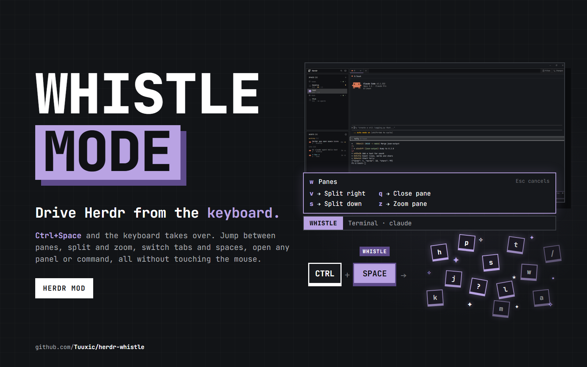

# Whistle

A keyboard mode for [Herdr](https://herdr.dev), borrowed from vim: switch out of typing to move
around the window and run commands with single keys and short key sequences.

Whistle has two modes. In **TYPE** the keyboard belongs to your terminal, as usual. Press
**Ctrl+Space** and you're in **WHISTLE**: `Ctrl+H/J/K/L` select a field (the terminal, the
spaces, tabs or agents list), `h/j/k/l` and the arrows move inside it, and keys and short key
sequences run Herdr's commands (`p` opens the palette, `w v` splits the pane). Press `i`, or
Ctrl+Space again, to type again.

Whistle draws nothing itself. **whistle-ui**, shipped beside it, shows what it does:

- **The bar**, a thin strip in the window, shows the mode and what has the keyboard. A short
  flash there says when a key isn't mapped or a command failed, and a `⚠` marker counts config
  problems.
- **The hints**, a box over the bar, list the keys that can follow while you're inside a group
  (after `w`, the pane keys).
- **Settings** list config problems and let you switch off the mappings other mods offer.

Hide the bar and whistle works the same; replace any part of whistle-ui with your own.

## Keys outside WHISTLE

Whistle leaves TYPE yours: only these keys act there, all regular lines in Herdr's `keys.json`.

| Key | Does |
|---|---|
| Ctrl+Space | Switch: TYPE to WHISTLE and back |
| Alt+A | Jump to the agents list, in WHISTLE |
| Alt+S | Jump to the spaces list, in WHISTLE |
| Alt+, | Settings (whistle-ui's) |

On macOS, where Option+letter types characters, the installing agent offers Ctrl+Shift+A,
Ctrl+Shift+S and Ctrl+Shift+, instead. If Ctrl+Space is taken on your setup (an input-source
switch, an IME), Ctrl+Shift+Space works in its place.

## Install

Ask your coding agent to add whistle from `herdr.dev/mods/Tuuxic/whistle`. It installs by
[RECIPE.md](RECIPE.md): it says what whistle changes before copying anything, adds the keys,
and makes the bar show. Afterwards it offers **Integrate**: your layout's lists (spaces, tabs,
agents, files, changes) become keyboard-usable fields, with a highlight on the selected one
and a cursor that moves without opening. The same agent updates whistle (and tells you what
changed) and uninstalls it.

## Docs

- [The guide](docs/guide.md): the modes, the default map, fields, your config
  (`whistle.json`), mods' mappings, the hints and settings, and what whistle does when
  something is wrong.
- [For authors](docs/authors.md): building a layout or a mod on whistle, through its five
  contracts.
- [CHANGELOG](CHANGELOG.md): what changed in each release, and how to upgrade.
- [CONTRIBUTING](CONTRIBUTING.md): tests, the sandbox and the release.

## License

MIT ([LICENSE](LICENSE)).
