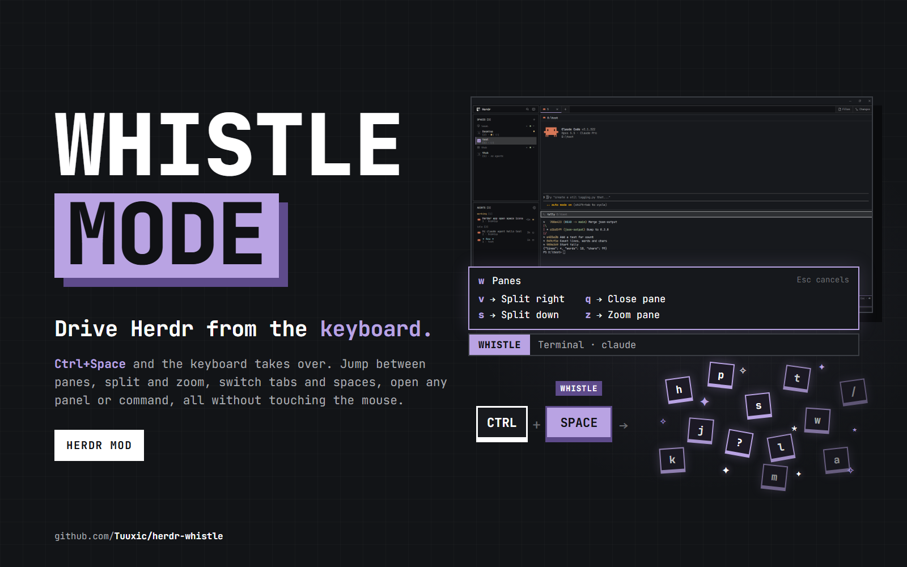

# Whistle

A vim-inspired mode for Herdr: switch out of typing to move around the window with single
keys. A thin bar shows which mode you're in: **TYPE**, where the keyboard belongs to the
terminal as usual, or **WHISTLE**, where whistle holds it.

> **Agents:** install, update and uninstall whistle by the [Install](#install),
> [Update](#update) and [Uninstall](#uninstall) sections at the end, not by AGENTS.md's add
> steps: re-adding makes a renamed second copy, which only stands aside. After Install, offer
> [Integrate](#integrate).



## What you see

- **Bar** (a block the layout places, else docked at the bottom, 22 px, on `chrome`, text
  11.5 px): on the left a mode badge, bold, 10 px side padding: **TYPE** outlined in the
  theme's `accent` (text in `accent`) or **WHISTLE** filled with `accent` (text in
  `accent_foreground`). Then, 10 px on, in `muted`,
  what has the keyboard: `Terminal`, or in WHISTLE `Terminal · <pane title>` (up to 40
  characters). A flash (a failed command, `w x is not mapped`) takes the label until the
  next key. While there are config problems, the bar ends with a marker in `blocked`, 10 px
  in from the right: `⚠ <count>`.
- **Hints** (a window overlay docked on top of the bar, as wide as the window, on `chrome` with
  an `accent` border, text 12 px): while a key sequence has reached a group in WHISTLE, a
  title row with the keys so far (bold, `accent`), the group's name (`foreground`) and, at
  the right in `dim`, `Esc cancels`; then the group's keys in columns filled top to bottom,
  each `key → label` (a further group's label `+Name` in `accent`).
- **Settings** (a dialog, 640 px wide, 80% high, on `chrome`): sections PROBLEMS (each
  `<source>: <detail>` in `blocked`, or "None"), MAPPING CONFLICTS (each conflict in `blocked`
  with a `Keep <mod>'s` button per mod), OVER MODS' KEYS (`g: you, over alpha`) and MODS'
  MAPPINGS (each mod with an on/off switch, its problems under it in `blocked`).
- **Inert**: no badge, only why, in the `blocked` color, 10 px in from the left:
  `Whistle needs Herdr ≥ 0.1.15 (this is 0.1.14)`, or on a second copy
  `Another whistle runs, from mods/whistle/` (that copy's bar hides itself, so it shows only
  if someone shows it again).

## How it behaves

- **Modes**: `ctrl-space` (keys.json `global`, `whistle.whistle`) enters WHISTLE on the
  terminal pane the keyboard just left; `ctrl-space` again (`mod:whistle`, `whistle.type`),
  `i` or Enter go back to TYPE in the selected pane. A click anywhere else ends WHISTLE; a
  click on the bar enters it.
- **Jump keys** (ADR 0014): a keys.json line `whistle.<verb>:<block>` (verbs `field`, `focus`,
  `toggle`, `toggle-keep-mode`; everything after the first colon is the block id, colons
  included) runs the verb from either mode and goes to WHISTLE; `toggle-keep-mode` keeps the
  mode. In WHISTLE it ends a key sequence first. A verb that can't run (no such block, a hidden
  block for `field`) stays in the mode and flashes; in TYPE the flash ends after 2 s. Switched
  off or inert, the key bound to it is typed into the terminal, like the switch key. A keys.json
  line with an unknown `whistle.` command is a config problem (`config.js` `keysProblems`).
  Shipped: `alt-a` → `whistle.focus:agents`, `alt-s` → `whistle.focus:spaces` (ids from Herdr's
  `main` layout).
- **Moving** (the default own keys): `ctrl-h/j/k/l` select the field in that direction (for
  now, terminal blocks); `h/j/k/l` and the arrows move between the selected terminal's split
  panes.
- **Config** (ADR 0004): layers, each over the one before: `mods/whistle/mappings.json` (the
  defaults), the layout's whistle block (`mappings` and `keys` props, the first block of this
  copy that has each), and `whistle.json` in Herdr's home. `map`: key → `[label, command,
  args?, "type"?]` or a group `{ name, map }` (nested; groups merge key by key); `keys`: own-key
  action → list of keys. `null` takes a key or action away. Outside a key sequence a mapping
  goes over an own key; in one, `cancel` ends it, `back` goes up a level, an unmapped key
  flashes `<keys> is not mapped`. A mapping runs its command (`pane.*`/`terminal.*` on the
  selected pane first), then the bar holds the keyboard for 600 ms, except for commands that
  take it themselves (`mod.open`, `app.*`, renames).
- **Failure** (issue #10): a file that doesn't parse runs on its last good version from this
  session; with none, whistle.json is left out and a missing or broken mappings.json gives the
  safety own keys built into `config.js` (`SAFETY`), a broken install. Every entry is checked
  (key names via `canonicalKey`, commands against Herdr's `commands()`, where a name outside
  Herdr's namespaces is a mod's command); a bad one is skipped and listed. Config problems are
  `model.problems` (`problems(model)` adds keys.json's). A command Herdr refuses when pressed
  only flashes. keys.json isn't written while whistle's files aren't read yet, either doesn't
  parse, or mappings.json is missing.
- **Claimed keys** (ADR 0001): whistle keeps its keys in keys.json's `mod:whistle` section
  (`mod:<folder>` for a renamed copy) as `"<key>": "whistle.key-<key>"`: every chord among its
  own keys, and any other own key the `global` section or the shown layout's section binds.
  Keys compare by canonical name (`keynames.js` `canonicalKey`: cmd/win/super are one
  modifier, `secondary` is cmd on macOS and ctrl elsewhere, modifiers in any order and case,
  an uppercase letter in a chord is shift). Entries of another form are the person's and win.
  It writes only when the section would change, one write at a time, never while keys.error
  exists or when there is no keys.json, and never while inert. 600 ms after a write it looks
  for keys.error; if Herdr rejected the text it writes the old text back and doesn't retry
  that text. A failed write is kept as a problem (`model.claimProblem`) and not retried until
  keys.json changes. `whistle.key-<key>` acts as the key pressed on the bar.
- **Inert**: on a Herdr older than the minimum in `version.js` (`updates().app.version`, or
  when that can't be read), or while another copy of whistle runs, whistle stands aside:
  WHISTLE never starts, keys and clicks on the bar do nothing, and the key keys.json binds to
  `whistle.whistle` (as it resolves from a terminal: `terminal`, then a layout's section,
  then `global`) is typed into the focused terminal instead. If WHISTLE was on, it goes back
  to TYPE first.
- **Copies**: each copy announces its folder in `shared("whistle.copies")`. Of this copy
  and the announced copies with a block in the shown layout, the one in `mods/whistle/`
  runs, else the first folder by name. The others are inert, hide their bars with
  `layout.hide` (only bars that were showing), and show them again once they run.
- **Bar spots**: each whistle block in a layout is a copy, told apart by its props
  (`props()`). A copy whose block is hidden rests: TYPE, no claims, no state, no spot moves;
  only the shown spot's copy runs (docs/contracts/layout-block.md, rule 6).
- **Hints and settings** (ADR 0011): the core works out their view models (`views.js`) and
  sets them in private shared keys, `whistle.hints` and `whistle.settings`, when they change;
  two more copies of the mod (prop `part: "hints"` / `"settings"`) draw them on each render
  and run no core. The core also opens, docks (`views.js` `hintsBox`, from the window and bar
  sizes the shell measures) and closes the hints window, as effects. Settings
  change things only by writing `whistle.json` (`config.js` `switchMod`, `keepMapping`, with
  the text just read as `expected`; never while it doesn't parse); the bar picks it up on its
  next read.
- **Whistle state**: the running copy publishes `shared("whistle") = { v: 1, mode, enabled,
  sequence, pane }` whenever it changes, and only then; an inert copy never writes it
  (docs/contracts/state.md). Every other `whistle.*` key is private.
- **Keynav fields**: a mod's block is a field once its entry `shared("keynav.field:<field
  key>")` says `v: 2`. Whistle names the selected one in `shared("keynav") = { v: 2, active }`,
  sends it moves and its declared keys as `<mod>.keynav-*` commands, and reads its request slot
  `shared("keynav.request:<field key>")`. Declared keys beat mappings but not own keys
  (docs/contracts/keynav.md).

## Built from

- **`mods/whistle/`**: a pure core, `step(model, input, world) -> { model, effects }`
  (`step.js`, with `fields.js` for the layout's fields, `inert.js` for the inert gate,
  `claims.js` for the keys.json section it wants, `config.js` for the layers, `keymap.js`
  for what a key means, `views.js` for the hints' and settings' models, `keynames.js`,
  `version.js`), behind one shell, `main.js`, that reads Herdr into `world`,
  feeds commands, key presses and a 120 ms tick through `step`, and carries out the effects;
  `bar.js`, `hints.js` and `settings.js` draw the bar, the hints and the settings. `whistle.js`
  is the helper other mods copy to read whistle state and offer mappings (whistle doesn't
  import it), and `keynav.js` the helper keynav
  fields copy. `mod.json`: `place: bottom`, size 22, `focusable: true`, and
  `version` / `herdr` repeating `version.js`.
- **`version.js`**: `VERSION`, `MIN_HERDR` and `HOME` (`"mods/whistle/"`, the copy's own
  folder; Herdr's add procedure rewrites it when it renames a copy).
- **`keys.json`** (repo root): `global: ctrl-space → whistle.whistle`,
  `alt-a → whistle.focus:agents`, `alt-s → whistle.focus:spaces`;
  `mod:whistle: ctrl-space → whistle.type`.
- **Herdr**: `layout()`, `focused()`, `panes()`, `keys()`, `updates()`, `window()`, `commands()`, `theme()`,
  `shared`/`setShared`, `nextCommand()`, `run` (`pane.focus`, `pane.go`, `layout.hide`,
  `layout.show`), `exec("hc", ["keys", ...])` to type the switch key through while inert.
  `readTextFile` / `writeTextFile` on `appHome()`'s `keys.json` (read every second, written
  with the text it read as `expected`) and `keys.error`, and reads `whistle.json` there
  every second; settings write `whistle.json` (with the text read as `expected`). No network; no other files outside its folder.
- **Tests**: `bash tests/run.sh` (`herdr-app check` on a throwaway test mod); not shipped.

## Watch out

- `updates()`, `keys()` and `commands()` are read through `import * as herdr`, so a Herdr without them
  still loads whistle, which then stands aside instead of failing to load.
- A copy counts only while it has a block in the shown layout: a copy whose block is gone
  doesn't keep another copy inert.
- Herdr can hand the keyboard back to a pane late after a command: after a pane move whistle
  holds the keyboard for 600 ms.

## Done when

- The bar shows a TYPE badge; `ctrl-space` turns it into WHISTLE with `Terminal · <title>`,
  `ctrl-space` again (or `i`) goes back.
- In TYPE in Herdr's `main` layout, Alt+A (Ctrl+Shift+A on macOS) goes to WHISTLE with the
  agents field selected, and Alt+S to the spaces field.
- With `mods/whistle/` and a copy in `mods/whistle-2/` both in the layout, the copy's bar
  hides itself and `mods/whistle/` runs.
- A `whistle.json` mapping `n` to `["Next tab", "tab.next"]` works in WHISTLE; breaking its
  JSON keeps `n` working and puts `⚠ 1` at the bar's end; fixing it takes the marker away.
- In WHISTLE, `w` shows the hints box above the bar listing the Panes group; `escape` closes it.
- In settings, switching a mod off that offers mappings writes `"mods": { "<mod>": false }`
  into `whistle.json` and its mappings stop working within a second.
- With `MIN_HERDR` set above Herdr's version, the bar says which Herdr whistle needs and
  `ctrl-space` reaches the terminal.
- After Install on Herdr's `main` layout, Integrate (simple path, Herdr's blocks) shows
  `main-whistle`; in WHISTLE, `j`/`k` on the spaces field move a cursor without opening a space
  and Enter opens it; the selected field glows in `accent`; files and changes are fields.
- Update, with a clone's `cloned_from.version` older than its original, offers to make that
  clone again; Uninstall offers to undo Integrate, and yes brings back `main` and deletes the
  clones and the record.

## Install

1. Read this recipe and every file in `mods/whistle/` first. Tell the person that whistle
   runs `hc` (to type a key into a terminal), writes only its own entries in keys.json's
   `mod:whistle` section, reads `whistle.json` (their own config) without writing it, and
   uses no network.
2. Check Herdr's version (`herdr-app --version`) against `"herdr"` in `mods/whistle/mod.json`.
   If Herdr is older, say whistle will stay inert until Herdr is updated.
3. Look for a whistle already there: any `mods/*/mod.json` with `"title": "Whistle"`. If
   there is one, follow [Update](#update) instead.
4. Copy `mods/whistle/` to `mods/whistle/`. If another mod already has that name, ask the
   person before renaming either; a renamed whistle needs `HOME` in its `version.js`
   rewritten to its folder, and a copy in `mods/whistle/` always wins over it.
5. Merge the repo's `keys.json` into the person's: add its sections and keys, and ask before
   replacing a key they already use. On macOS, Option+letter types characters, so propose the
   jump keys as `ctrl-shift-a` / `ctrl-shift-s` instead of `alt-a` / `alt-s`. If the person's
   layout has no `agents` or `spaces` block, say the jump keys name blocks by id and offer to
   point them at their layout's ids.
6. `herdr-app check mods/whistle`.
7. Offer [Integrate](#integrate): "Whistle can drive Herdr's spaces, agents and tabs as they
   are, but with no cursor (moving opens), and files and changes not at all. I can make
   keynav copies of your layout's blocks with a cursor and a look for the selected one. Do
   that?" If the person says yes, follow Integrate; if not, say they can ask for it any time.

## Integrate

**Integration** (ADR 0015) makes the blocks of the person's shown layout into keynav fields,
with a look for the selected field and a cursor that moves without opening. It is
instructions for you, not part of whistle: whistle's code doesn't change, whistle ships no
clones and never reads the record, and a keynav mod works the same without whistle. Herdr's
own blocks stay stock fields (no cursor, moving opens) for anyone who doesn't integrate.

Offer it after Install's last step. Do it at any other time the person asks.

### Before you start

- **The shown layout**: `"layout"` in `herdr-app status`. Integrate only that one, unless the
  person picks more on the advanced path.
- **Herdr's own** layouts and mods are the names in Herdr's `installed.json` (a mod by its
  folder, a layout as `layout:<name>`). They are read-only: Herdr replaces them on every
  start and moves an edited one aside, so clone them and never edit them.
- **The person's own** mods and layouts are the others that they wrote, and every clone (its
  `mod.json` or layout has `cloned_from`). Change those in place.
- **Third-party** mods came from somewhere else (herdr.dev, someone's repository: usually a
  README, a LICENSE or an author in the folder). When you can't tell, treat a mod as
  third-party.
- **Already fields, left as they are**: terminal blocks (`content` is a `pane`, `tab`,
  `terminal` or `agent`), mods that already speak keynav v2 (a `keynav.js` with `V = 2` whose
  `announce` the mod calls), and whistle's own blocks (`"title": "Whistle"` in the mod's
  `mod.json`). A mod still on keynav v1 (`shared("keynav.fields")`) is adapted: its
  `keynav.js` is replaced and its calls changed as below.

### Simple path

Ask one thing: **Herdr's blocks** only, or **all blocks**.

- **Herdr's blocks** are the blocks with the ids `spaces`, `agents`, `tabs`, `files` and
  `changes`, whatever mod sits there now. A layout with none of these ids has no Herdr's
  blocks: say so and offer all blocks instead.
- **All blocks**: every mod block in the layout that isn't already a field.

Then, without asking more:

1. **The layout.** If it is one of Herdr's own, clone it and show the clone:
   `herdr-app do layout.clone '{"name":"<name>","as":"<name>-whistle"}'` (it switches to the
   clone; `herdr-app do layout.switch '{"name":"<name>-whistle"}'` if it didn't). If the name
   is taken, ask before using another. The person's own layout is changed in place.
2. **The mods.** For each block to adapt: Herdr's mods and third-party mods are cloned,
   `herdr-app do mod.clone '{"name":"<mod>","as":"<mod>-whistle"}'`, and the block's
   `content.mod` in the layout file (`layouts/<layout>.json`) is pointed at the clone. Blocks
   of one mod share one clone. The person's own mods are changed in place.
3. **Keynav** for each of those mods, as in
   [How a mod becomes a field](#how-a-mod-becomes-a-field), with whistle's suggested look:
   - The selected field **glows**: while it is active, the block's outer element (made
     `.relative()`) gets a last child `div().absolute().inset_0()` with a `border_2()` in the
     theme's `accent` and the element's own corner radius, so nothing moves.
   - The **cursor item** gets a 1 px `accent` outline. Give every item a 1 px border, in
     `accent` on the cursor item and transparent (`accent + "00"`) on the others, so rows
     don't shift. Items that already have a border (Herdr's tabs) keep it and turn it
     `accent` on the cursor item.
4. **Declared keys** only for actions the mod already has, acting on the cursor item. For
   Herdr's blocks:

   <!-- table integrate-keys -->
   | Block | Key | Label | Herdr command |
   |---|---|---|---|
   | `spaces` | `n` | New space | `space.new` |
   | `spaces` | `r` | Rename | `space.rename` |
   | `spaces` | `x` | Close | `space.close` |
   | `agents` | none | | |
   | `tabs` | `n` | New tab | `tab.new` |
   | `tabs` | `r` | Rename | `tab.rename` |
   | `tabs` | `x` | Close | `tab.close` |
   | `files` | none | | |
   | `changes` | none | | |

   `n` runs the command with no args; `r` and `x` pass the cursor item, `{ "id": <its id> }`
   (Herdr asks for the name, and asks before closing a space). For other mods, declare keys
   for the mod's clear actions on one item (what its buttons or its menu do to an item),
   never a chord and never one of whistle's own keys (the `keys` in `mods/whistle/mappings.json`
   and the person's `whistle.json`: `h`/`j`/`k`/`l`, the arrows, `enter`, `i`, `escape`,
   `backspace` by default).
5. **Check** each mod you changed, write the [record](#the-record), and tell the person what
   you made, that `ctrl-h/j/k/l` in WHISTLE now reach those fields, and that Uninstall offers
   to undo it.

### Advanced path

The person chooses; you do the rest as on the simple path:

- **The layouts**: the shown one and any others. Herdr's own are cloned as on the simple path.
- **The blocks** of each layout to make fields.
- **The look** of the selected field (glow, border or background; color and width) and of
  its cursor item. Use the theme's colors (`accent`, `selected`, `foreground`, …), not fixed
  ones.
- **The declared keys** of each field: which keys, their labels, what each runs.
- **Clone or in place** for each third-party mod. In place, the mod's next update from its
  author may remove the change; Update offers to add it again.

### How a mod becomes a field

By `docs/contracts/keynav.md`; read it first. In the mod's folder (the clone, or the person's
own mod):

1. **Copy** `mods/whistle/keynav.js` into the folder.
2. **Announce** from `render`, in the copy drawn as a layout block only, not in a copy the mod
   opens as an overlay with its own props (such as agents' sort menu):
   `this.key = announce("<mod folder>", props() ?? {}, "<Label>", { <key>: "<label>" })`,
   with the folder's own name (`spaces-whistle` for a clone), the block's title as the mod
   shows it, and the declared keys (`{}` for none).
3. **A cursor** over the items a click acts on, in the order they are shown (rows, tabs, the
   files and folders the tree shows). Keep it as the item's id, not its index, so it survives
   the list changing. In `render`, before drawing the items, settle it:
   `if (entered(this, this.key))` put it on the item that is current now (the shown space,
   the focused agent, the shown tab, the open diff), else the first; if its item is gone, on
   the first. Herdr refuses `cx.notify()` during `render`, so where the items are only known
   once drawn (agents' rows, files' tree), draw them, settle the cursor, and draw them again
   if it moved. Scroll it into view where the mod has a scroll handle (tabs).
4. **Commands**: read `nextCommand()` in a loop started in `init(_props, cx)` (in the block's
   copy only; if the mod already reads commands, add to its loop: each command reaches one
   reader):
   `cx.spawn(async (cx) => { for (;;) { this.keynav(await nextCommand(), cx); cx.notify(); } })`
   (pass `cx` on where the mod's own click handlers need it).
   `keynav(c)` does nothing unless `isActive(this.key)`. `move(c)`: `up`/`down` move the
   cursor through a list (`left`/`right` through a row, such as tabs) without opening anything;
   `open` does what a click on the cursor item does; in a tree, `left` closes the cursor's
   open folder, and a preview's back button is `left` too. `declared(c)` runs that key's
   action on the cursor item.
5. **Requests**: after `open` focused a terminal pane (an agent's), call
   `toTerminal(this.key)`; after it showed something else (another space or tab), call
   `keepKeys(this.key)`.
6. **The look**, drawn only while `isActive(this.key)`: the field's glow and the cursor item's
   outline. Without a driver nothing is active and the mod looks as before.
7. Change nothing else: the mod still works by mouse as it did.
8. **Check**: `bash kit/keynav-checker/check.sh <mod folder>` (from whistle's repo, or copy
   `kit/keynav-checker/` as keynav.md says) and `herdr-app check <mod folder>`; both must
   pass.

A clone of a Herdr mod (`spaces-whistle`) is a field like any keynav mod: whistle's stock
field table names only Herdr's own mods, so it never applies to the clone.

### The record

Write `whistle-integration.md` in Herdr's home (next to `keys.json`). Whistle never reads it;
Update and Uninstall do. Keep this form, one row per layout and per mod:

```md
# Whistle integration

Made by an agent following whistle's RECIPE.md (Integrate). Whistle never reads this file.

- Made: 2026-11-15, whistle 1.0.0, Herdr 0.1.15, simple path (Herdr's blocks)

## Layouts

| Layout | Original | Version | How |
|---|---|---|---|
| main-whistle | main | 0.1.15 | clone |

## Mods

| Mod | Original | Version | How | Blocks | Look | Declared keys |
|---|---|---|---|---|---|---|
| spaces-whistle | spaces | 0.1.15 | clone | main-whistle: spaces | suggested | n space.new, r space.rename, x space.close |
| notes | notes | 1.2.0 | in place | main-whistle: notes | suggested | d Delete |

## In-place changes

- notes: added keynav.js; main.js: announce, cursor, keynav commands, look
```

- **Version**: the original's version when you made it. For a clone, its `cloned_from.version`
  (Herdr's version for Herdr's own); for an in-place mod, `"version"` in its `mod.json`, or
  `none`.
- **How**: `clone` or `in place`. List every file you added or changed in place under
  **In-place changes**, so the change can be found and taken out again.
- **Look**: `suggested`, or what the person chose.
- Integrating again later adds rows and keeps the old ones.

## Update

Update in place: whistle never shows an "updated" notice, so what changed reaches the person
only through you.

1. Find every copy: each `mods/*/mod.json` with `"title": "Whistle"`. The old version is
   `"version"` in the copy's `mod.json`. **A copy without `version.js` is older than 1.0:
   also apply v1.0.0's Upgrading note in `CHANGELOG.md` in full.**
2. Replace the contents of `mods/whistle/` with the new `mods/whistle/`: copy every file over
   and delete the files the new version doesn't ship. Don't rename anything. If the only
   copy is in another folder, move it to `mods/whistle/` and update it there.
3. Other copies stay inert while `mods/whistle/` runs. Ask before deleting them.
4. Never touch `~/.config/herdr-app/whistle.json`, and don't merge `keys.json` again:
   whistle reconciles its own `mod:whistle` keys. Change keys.json only where an Upgrading
   note says to.
5. Read `CHANGELOG.md` and tell the person about every entry newer than the old version,
   breaking ones first; follow each entry's **Upgrading** note.
6. `herdr-app check mods/whistle`.
7. **Integration**: if `whistle-integration.md` is in Herdr's home, read it. Clones never get
   their original's updates on their own, so for each row:
   - A **clone** whose original is newer than the version the record and its
     `cloned_from.version` give (Herdr's own: `herdr-app --version`; others: `"version"` in
     the original's `mod.json`): tell the person and offer to make it again from the new
     version. Yes: move the old clone aside (`<name>-whistle-old`), clone the original again
     under the old clone's name (`mod.clone` / `layout.clone` refuse a taken name), make it a
     field again with the look and declared keys the record gives (a layout: point its blocks
     at the clones again), check it, then delete the old one. Changes the person made to the
     old clone by hand are lost; say so first. A layout clone keeps the person's clicks only
     if it is not made again.
   - An **in-place** mod whose keynav change is gone (no `keynav.js`, or the files listed under
     **In-place changes** no longer have it; its author's update replaced them): offer to add
     keynav again, the same way.
   - Update the record's versions and rows for what you made again.

## Uninstall

1. **Integration**: if `whistle-integration.md` is in Herdr's home, read it and offer to undo
   it. Yes: if a `-whistle` layout from the record is shown, show its original again
   (`herdr-app do layout.switch '{"name":"<original>"}'`); delete each clone the record lists
   (`layouts/<name>.json`, `mods/<name>/`); take the in-place keynav changes out of the files
   listed under **In-place changes**; delete the record. No: leave all of it; tell the person
   the fields keep working without whistle (they only show their look while a driver selects
   them), and that the clones no longer get updates, since only whistle's Update looks for
   them.
2. Delete every copy (each `mods/*/` whose `mod.json` has `"title": "Whistle"`).
3. In keys.json, remove the `mod:whistle` section and every binding to a `whistle.*` action.
4. Ask before deleting `~/.config/herdr-app/whistle.json`, the person's own settings.
5. Tell the person that whistle blocks in their layouts will now show nothing, and offer to
   remove them.
