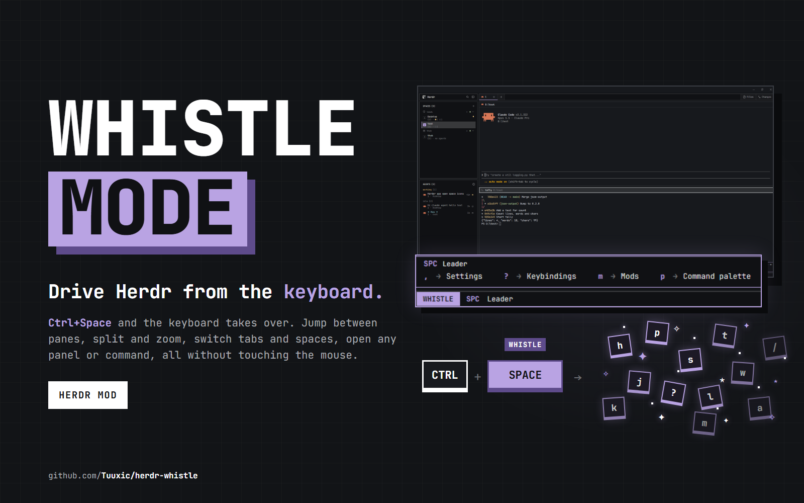

# Whistle

A vim-inspired mode for Herdr: switch out of typing to navigate and control the whole
interface with simple key sequences. A thin bar shows which mode you're in; in WHISTLE,
single keys move between the window's fields and short sequences run commands, with a hints
box listing what can follow.

## What you see

- **Bar** (a block the layout places, else docked at the bottom, 22 px): on the left a
  mode badge, bold, 10 px side padding: **TYPE** on the theme's `done` color or **WHISTLE**
  on `accent`, text in `background`. A click on it opens whistle's settings. Then, muted, what
  has the keyboard: `Terminal`, `Terminal · <pane title>` (up to 40 characters), or the
  selected field's label (`Spaces`, `Agents`, `Files`, ...). While a sequence is pending it
  shows the keys typed so far in bold accent (`SPC a`) and the group's name (`App`). An error
  or "x is not mapped" shows in the `blocked` color in place of the label.
- **Hints box** (only while a sequence is pending, if hints are on), laid out like which-key's
  classic preset: a borderless window overlay docked on top of the bar, exactly as wide as it,
  `hintsLift` px (default 6) above it. Background `chrome`, a 1 px `accent` border all round.
  A title row (22 px): the keys typed (bold accent), the group's name, and on the right
  `Esc · ⌫` dim. Below, 12 px side padding, the group's keys in columns filled top to
  bottom, as many columns as fit, each as wide as its own longest key and label (about 7.2 px
  a character), 32 px apart; rows 18 px: the key in bold accent (`space` shows as
  `SPC`), a dim `→`, the label (a nested group in accent with a `+`). Commands come before
  groups, each sorted by key. Reopened at the new size when the group changes.
- **Settings dialog** (640 px wide, 80 % of the window high): "Whistle" and "Esc closes";
  two rows with square toggles (36×20, accent when on): **Whistle mode** and **Show key
  hints** (hidden while whistle is off); **Bar position** when the layout has more than one
  bar: a dropdown (190 px, ▾) whose list, under it, ticks the bar shown; `MAPPINGS · n` and every mapping in effect, one row
  each: the keys as small bordered chips joined by `›`, the label, the group name dim on the
  right; a note on where your own mappings go.
- **Fields**: whistle draws nothing in other blocks. Each mod that takes part draws its own
  highlight while it's the active field (see keynav below); the terminal pane's header may
  light up through `shared("keynav").pane`.

## How it behaves

- **Modes**: regular keys.json keys. `ctrl-space` toggles; `ctrl-[` in a terminal only enters
  (it's Esc in vim, so it never leaves). Entering selects the terminal pane the keyboard just left. `i` (or Enter on
  the terminal) goes back to TYPE in the selected pane. A click anywhere else ends WHISTLE.
  Commands that open a dialog, the palette or a rename prompt hand the keyboard over and end
  in TYPE.
- **Own keys** (the `keys` section, action → keys, configurable in every config layer;
  `null` removes an action): the defaults are named below.
- **Claimed keys**: keys.json's `mod:whistle` section holds `"<key>": "whistle.key-<key>"` for
  every ctrl/alt/super chord among the own keys and the map, and for any other of those keys
  a global or layout section binds. Whistle owns only entries of exactly that form: it adds
  and removes them, the rest of the section stays as written. It writes only on a change,
  not while `keys.error` exists, and restores the old text if a `keys.error` appears after
  its write; the bar shows the problem.
- **Key names**: the character typed (`?`, `X`), else the key's name (`f2`, `shift-tab`);
  with ctrl/alt/super held, the lowercase key with every modifier in front, shift included
  (`ctrl-shift-x`), as keys.json spells it.
- **Moving between fields**: `ctrl-h/j/k/l` pick the field in that direction from the
  layout's rows and columns; entering a group of blocks lands on the field used there last,
  else its terminal, else its first. Hidden blocks and the unselected children of a stack
  don't count. The whistle block's `nav` prop overrides single steps.
- **Inside a field**: on the terminal, `h/j/k/l` and arrows move between split panes. On any
  other field, `j/k/h/l`, arrows and Enter go to that field's mod as keynav moves (`down`,
  `up`, `left`, `right`, `open`); any other plain character that isn't mapped goes as
  `key-<char>`.
- **Mappings**: a key from the map runs its command, or starts a group whose keys follow
  (`w v`); groups nest. Esc cancels, Backspace goes back a
  level. A mapped key beats the own keys above. Pane and terminal commands act on the
  pane whistle has selected. Commands keep you in WHISTLE; an entry's 4th item `"type"` ends
  in TYPE and lets the terminal the command opened take the keyboard.
- **Agent statuses**: whistle shows none itself; the fields' own mods do.
- **Off** (`"enabled": false`): the keys keys.json binds to `whistle.whistle` and
  `whistle.enter` (as they resolve from a terminal: terminal, then layout, then global) are
  typed into the focused terminal (`hc keys <terminal> ctrl+space|esc`), other whistle
  commands except `settings`, `on` and `off` are ignored, and the bar shows only its
  label.
- **Config problems**: while mappings.json or whistle.json doesn't parse, or keys.json
  can't take whistle's keys, the bar shows the problem (in any mode); the settings dialog
  shows parse errors and warns when no key enters WHISTLE.

## Built from

- **Files** (in `mods/whistle/`; `keys.json` at the top): `main.js` (the view: bar
  copy, `part: "hints"` window copy, `part: "settings"` dialog copy), `config.js` (mapping
  layers, own keys), `keymap.js` (pure key resolver: what a key means in WHISTLE, and the
  hints for a pending sequence; `main.js` carries it out), `keysync.js` (keys.json: the
  claimed keys, the key bound to a command), `keynames.js` (key names and labels),
  `hints.js`, `settings.js`, `keynav.js` (the protocol), `mappings.json` (defaults),
  `keys.json`, `mod.json` (`place: bottom`, size 22, `focusable: true`).
- **Tests**: `tests/run.sh` copies `config.js`, `keynames.js`, `keymap.js` and the test mod in
  `tests/` into a temp folder and loads it with `herdr-app check`; a failing case throws, so
  the check fails listing every failure. `tests/` isn't part of the shipped mod.
- **Config layers**, each over the one before; a key set to `null` removes it, groups merge
  key by key: `mappings.json` (Herdr's own commands only) < the whistle block's `mappings`
  prop (and its `enabled` / `hints` / `keys` props, so a layout can ship whistle off) < `~/.config/herdr-app/whistle.json` (`{ enabled, hints, bar, keys, map }`, read every 2 s since
  it's outside the mod's folder). An entry is `[label, command]`, `[label, command, args]` or
  `[label, command, args, "type"]`; `name:value` fills the command's first argument.
- **Its own commands** (`whistle.<command>`, from keys.json): `whistle` (toggle), `enter`,
  `type`, `focus`, `left/down/up/right`, `key-<name>` (as if pressed, for scripts). From
  mappings: `whistle.field:<block>`, `whistle.focus:<block>` (show it, then select it),
  `whistle.toggle:<block>` (show it, or hide the nearest group that holds only it),
  `whistle.settings`. For other mods' settings: `whistle.on` / `whistle.off` set `enabled`
  in whistle.json, and the bar keeps `shared("whistle.enabled")` (true/false) current.
- **keynav v1**: a mod announces each copy in `shared("keynav.fields")` as
  `{ v: 1, mod, props, label }` keyed by `fieldKey(mod, props)`; whistle finds those blocks in
  `layout()`, publishes `shared("keynav") = { v: 1, active, pane }` (`active` is a field key,
  `"terminal"` or null outside WHISTLE) and runs `<mod>.keynav-<move>`. A mod asks for
  `{ to: "terminal" }` (it focused a terminal) or `{ hold: true }` (it moved the keyboard,
  keep it) in `shared("keynav.request")`. `shared("whistle.sequence")` carries the pending
  sequence to the hints window.
- **Herdr API**: `focused()`, `panes()`, `layout()`, `commands()`, `shared`/`setShared`,
  `nextCommand()`, `openOverlay`/`closeOverlay` (`kind: "window", frame: "none"` for the hints,
  `"dialog"` for settings), `readTextFile`/`writeTextFile`, `exec("hc", ...)`; commands
  `pane.focus`, `pane.go`, `layout.show/hide/select`.
- **Programs**: `hc` (only while whistle is off). No network.

- **Several bars**: a layout can hold more than one whistle block, each named by a `bar`
  prop (`"Full width"`, `"Under the terminals"`), all but one hidden. `bar` in whistle.json
  (set from the settings dialog) names the one to show; whistle shows it with `layout.show`
  and hides the rest. A hidden copy stays alive but does nothing. A bar without mappings
  takes the props of the layout's first bar that has them, so they're written once. The
  hints box lines up with the bar: its left edge is the window's width less the bar's (a bar
  always reaches the right edge). A bar set in from the edges says by how much in its props:
  `hintsInset` (px from the window's right edge to the bar's inside), `hintsBorder` (its
  border width, so the box covers it) and `hintsLift` (px from the bar's inside top to the box).

## Watch out

- A command that moves the keyboard (a pane focus, a space switch) can take it back from
  whistle a moment later: after each command whistle re-takes the keyboard for 600 ms
  (`hold`), and after a `"type"` mapping it waits up to 1 s for the new terminal.
- Opening a dialog ends WHISTLE (the dialog has the keyboard); there's no way back into the
  field you came from except `ctrl-space`.
- A window overlay doesn't take the keyboard, a popup would (and Esc closes popups): keep the
  hints a `kind: "window"`.
- Two mods announcing in the same moment can overwrite each other in `keynav.fields`; mods
  re-announce from `render` when they find themselves missing.
- Fields only exist for mods that copy `keynav.js`; a layout of Herdr's own mods gives the
  terminal field and the mappings, nothing else.
- keys.json runs before whistle sees a key, so a key bound in any active section (a layout's
  `ctrl-h → tab.prev`) never reaches it; keys.json's `mod:whistle` section wins only while
  whistle has the keyboard. Hence the claimed keys.
- Editing keys.json makes it the person's for Herdr: an untouched file stops getting new
  default shortcuts. Whistle writes it only when its claims change.
- Through a junction or symlink, saving a file in the mod's folder doesn't reload it (seen
  on Windows); recreate the link or restart Herdr.
- Saving a file in the mod's folder reloads it, back to TYPE.

## Done when

- The bar shows a TYPE badge; `ctrl-space` turns it into WHISTLE with `Terminal ·
  <title>`, `ctrl-space` again (or `i`) goes back.
- In WHISTLE, `w` opens the hints box above the bar listing the Panes group, Esc closes
  it; the bar shows `w Panes` meanwhile. `p` opens the command palette.
- `w v` splits the selected pane and whistle stays in WHISTLE.
- With a keynav mod in the layout, `ctrl-h` selects it (its own highlight shows, the bar
  shows its label) and `j` moves its cursor.
- A click on the badge (or `whistle.settings`) opens the settings dialog; turning Whistle mode off
  removes the badge, after which `ctrl-[` in a terminal types Esc.
- A key set in `~/.config/herdr-app/whistle.json` works within a few seconds of saving, and
  shows in the settings dialog's list.
